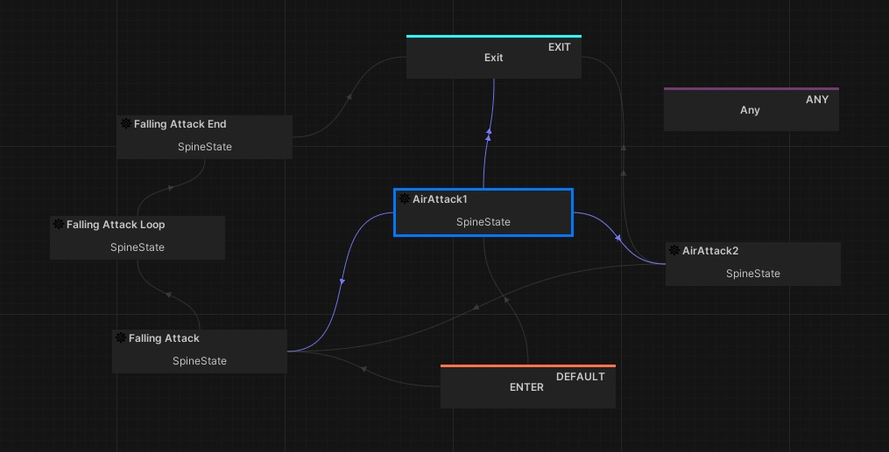

# Behaviour HFSM Module for Unity



## HFSM Module Details

The `com.deathbygravitystudio.behaviour.hfsm` package provides a modular Hierarchical Finite State Machine (HFSM) system for Unity. It is designed for advanced state management, supporting nested states, transitions, and extensibility via services and custom state types. Key features include:

- **Node-based Architecture:** Each state is represented as a node (ScriptableObject) that can contain transitions, services, and hierarchical relationships (parent, layer).
- **Extensible State Interfaces:** Includes interfaces for different state types, such as `IBaseState`, `IAnimatableState`, `IComposedState`, and `ITimedState`, allowing for flexible and composable state logic.
- **Services and Utilities:** Supports attaching services (via `IService`) and timeouts to states for advanced behaviours.
- **Sample Scene:** Comes with a sample scene demonstrating practical usage of the HFSM system.
- **Shared Variable System:** Integrates with the shared variable package for state data management.

Use this package when your Unity project needs nested states, explicit transitions, and optional per-state services.

## Note
This project is a work in progress. Features and documentation are subject to change.

## Installation

Install this package with the Unity Package Manager from a Git URL:

`https://github.com/denchi/UnityBehaviorHFSM.git`

In Unity, open **Window > Package Manager**, choose **Add package from git URL...**, and paste the URL above.

This package depends on the shared variable package (`com.deathbygravitystudio.behaviour.vars`). Add that sibling package from its Git URL as well:

`https://github.com/denchi/UnityBehaviorVars.git`

Both URLs can be declared in the project `Packages/manifest.json`:

```json
{
  "dependencies": {
    "com.deathbygravitystudio.behaviour.hfsm": "https://github.com/denchi/UnityBehaviorHFSM.git",
    "com.deathbygravitystudio.behaviour.vars": "https://github.com/denchi/UnityBehaviorVars.git"
  }
}
```

The included sample scene is at `Samples~/SampleScene`. Import it from this package's Samples list in Package Manager.

## Related packages

- [UnityBehaviorTree](https://github.com/denchi/UnityBehaviorTree) — behaviour tree (`com.deathbygravitystudio.behaviour.tree`)
- [UnityBehaviorGraph](https://github.com/denchi/UnityBehaviorGraph) — graph execution (`com.deathbygravitystudio.behaviour.graph`)
- [UnityBehaviorVars](https://github.com/denchi/UnityBehaviorVars) — shared variables (`com.deathbygravitystudio.behaviour.vars`)
- [UnityBehaviorDialogs](https://github.com/denchi/UnityBehaviorDialogs) — dialog (`com.deathbygravitystudio.behaviour.dialog`)

## Licence

This package is released under the MIT Licence. See [LICENSE](LICENSE).

Copyright (c) 2026 Denis Chiriac / Death By Gravity Studio.
